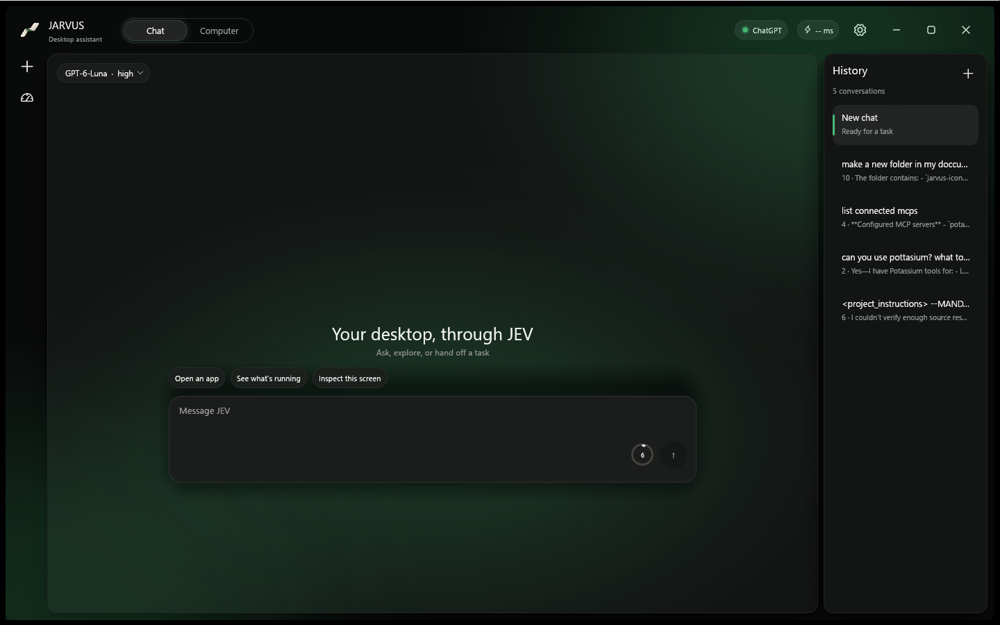

# JARVUS

JARVUS is a native desktop assistant for Windows, with macOS support in progress. **JEV** is its local executor: it observes app controls, carries out bounded actions, and returns fresh results. The connected ChatGPT model plans the work, reviews those results, and decides what to do next.

> Project status: active development. macOS support is being implemented and is not yet verified end to end. macOS builds are experimental until they pass an interactive runtime check on a Mac.

<p align="center"></p>

## Screenshot



Chat with tool history on the left, conversation history on the right, model picker and context meter in the composer.

## What it does

- Streams conversations with the model selected from the signed-in account's available catalog.
- Routes local desktop and browser tasks through JEV and returns tool results to the model for follow-up reasoning.
- Uses Agent Desktop accessibility controls for desktop observation and actions; it does not send screenshots to the model by default.
- Provides browser and MCP connections over local stdio, Streamable HTTP, and legacy HTTP+SSE transports.
- Stores chat metadata, message history, and tool traces per conversation under `~/.jarvus/chats/`; settings live in `~/.jarvus/`.
- Keeps authentication credentials in the operating system's credential store rather than the chat files.

Desktop automation is permissioned by the operating system. On macOS, JARVUS requires Agent Desktop's Accessibility permission; screenshot capture also requires Screen Recording permission. Review the permission prompt before enabling it.

## Requirements

### Windows development

- Windows 10 version 1809 or newer
- Rust stable toolchain with Cargo
- Node.js 18 or newer
- Agent Desktop installed for the current user:

```powershell
npm install --global agent-desktop
agent-desktop version
```

### macOS support in progress

- macOS 13 or newer (Intel or Apple Silicon)
- Xcode Command Line Tools (`xcode-select --install`)
- Rust stable toolchain with Cargo
- Node.js 18 or newer and Agent Desktop:

```sh
npm install --global agent-desktop
agent-desktop status
agent-desktop permissions --guide
```

Agent Desktop uses macOS Accessibility APIs. Grant Accessibility access to the process that launches JARVUS when prompted. Grant Screen Recording only if using screenshot capture. macOS builds are experimental until a Mac runtime pass verifies launch, permissions, browser connection, and desktop actions.

## Build and run

From the repository root:

```sh
cargo run --locked --bin jarvus
```

Build an optimized Windows executable on Windows:

```powershell
cargo build --release --locked --bin jarvus
```

The executable is `target/release/jarvus.exe`. An experimental native macOS binary can be built on a Mac:

```sh
cargo build --release --locked --bin jarvus
```

GitHub Actions builds macOS x64 and Apple Silicon artifacts on macOS runners. The workflow is a build pipeline; successful compilation does not replace interactive macOS accessibility and permission verification.

## Sign in

Use **Sign in with ChatGPT** in JARVUS. The app starts the Codex device authorization flow, opens the official device page in the default browser, and displays the one-time code to enter there. Tokens are stored with the operating system credential service. JARVUS sends prompts and the tool results required for the answer to the connected ChatGPT service. Local screenshots, full accessibility trees, and unrelated local files stay on the PC unless the user shares their contents.

## Data and privacy

JARVUS keeps application data in the current user's `.jarvus` directory:

```text
~/.jarvus/
  settings.json
  mcp-servers.json
  chats/
    <chat-id>/
      metadata.json
      history.json
      toolcalls.json
```

On Windows, `~` is the user's profile directory, for example `C:\Users\Alice\.jarvus`. The app migrates legacy Windows conversation and settings files when they are found. Credential values use the operating system credential store. Do not attach `~/.jarvus` to bug reports; it may contain private chat content or connection configuration.

Tool calls are visible in the conversation. A successful sequence of local steps is not, by itself, proof that a longer user goal is complete: research and multi-step work must be checked against the requested outcome before JEV reports completion. Sending messages and other consequential actions should only occur when the user's request clearly authorizes them.

## MCP servers

Open **Settings → MCP servers** to import or manage servers. JARVUS supports local stdio, Streamable HTTP, and legacy HTTP+SSE MCP transports. Use HTTPS for remote servers and keep bearer tokens in the app's credential storage. Never paste secrets into screenshots or public issue reports.

The built-in Chrome extension is a **browser bridge**, not an MCP server. The built-in **Shell** connection supplies bounded local command, file, directory, and HTTP(S) fetch tools. When asked what is connected, JEV queries live inventory and reports configured MCP servers, browser bridges, and local connections as separate groups.

## GitHub builds and releases

The macOS workflow runs on pushes, pull requests, and manual dispatch. It creates separate macOS x64 and Apple Silicon executable archives; a published GitHub Release also receives the matching archives. These are unsigned executable archives, not a signed or notarized `.app` installer.

Build and stage the Windows executable locally:

```powershell
.\scripts\release.ps1 -Bump patch
```

After reviewing, committing, and tagging that version, upload the Windows executable to an existing GitHub Release:

```powershell
.\scripts\release.ps1 -Upload
```

The upload option requires GitHub CLI authentication, a configured `origin`, a matching version tag, and an existing release. It never pushes source changes. A repository remote must be configured before uploads can work.

## Project map

| Path | Purpose |
| --- | --- |
| `src/app.rs` | Native workspace, settings, chat history and tool activity UI |
| `src/chat.rs` | Model catalog, streamed responses and tool-call loop |
| `src/jev.rs` | Local tool routing and bounded desktop plans |
| `src/desktop.rs` | Agent Desktop process adapter, snapshots and actions |
| `src/mcp.rs` | MCP configuration, server connections and tool dispatch |
| `src/browser.rs` | Chrome extension bridge |
| `src/chat_store.rs` | Per-chat files, migration and persistence helpers |
| `src/system_prompt.md` | JEV operating rules and workflow examples |
| `src/toolset.json` | Model-facing function schemas |
| `chrome-extension/` | Browser extension and native messaging manifest |
| `JARVUS VAULT/` | Obsidian project notes |
| `.planning/` | Requirements, roadmap, debug notes and project state |

## Current limits

- macOS releases need an interactive Mac verification pass for permissions, app launch, browser connection, and desktop actions.
- Agent Desktop can only act on controls its accessibility provider exposes. When a target is missing or ambiguous, JEV should stop and report the limitation instead of guessing.
- A successful build does not prove that a ChatGPT account, MCP server, browser extension, or third-party desktop action works end to end.
