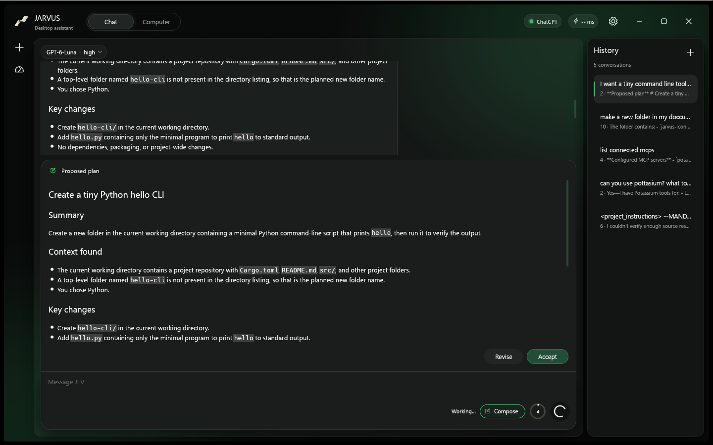
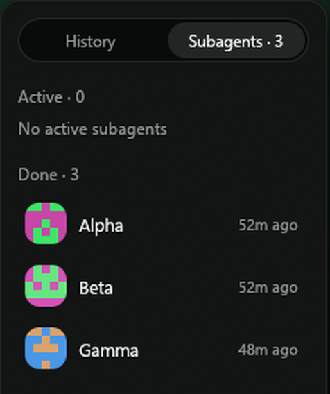

# JARVUS

JARVUS is a native desktop assistant for Windows and macOS. **JEV** is its local executor: it observes app controls, carries out bounded actions, and returns fresh results. The connected ChatGPT model plans the work, reviews those results, and decides what to do next.

> Project status: active development. Windows is the primary, tested platform. The macOS build compiles, passes the unit tests and is packaged by GitHub Actions on real Macs, but its pointer, keyboard and accessibility actions have not had an interactive run on a Mac yet; treat it as a beta.

<p align="center"></p>

## Screenshot


Chat with tool history on the left, conversation history on the right, model picker and context meter in the composer.

## What it does

- Streams conversations with the model selected from the signed-in account's available catalog.
- Routes local desktop and browser tasks through JEV and returns tool results to the model for follow-up reasoning.
- Uses Agent Desktop accessibility controls for desktop observation and actions; it does not send screenshots to the model by default.
- Provides browser and MCP connections over local stdio, Streamable HTTP, and legacy HTTP+SSE transports.
- Stores chat metadata, message history, and tool traces per conversation under `~/.jarvus/chats/`; settings live in `~/.jarvus/`.
- Keeps authentication credentials in the operating system's credential store rather than the chat files.

Desktop automation is permissioned by the operating system. On macOS, JARVUS requires Agent Desktop's Accessibility permission; screenshot capture also requires Screen Recording permission. Review the permission prompt before enabling it.

## Core skills, Shell and sessions

JEV always follows two built-in skills adapted from [obra/superpowers](https://github.com/obra/superpowers) (MIT): **systematic debugging** (root cause before any fix) and **brainstorming** (understand what the user wants before building). The Shell package's `run_command` runs anything a terminal can (PowerShell, cmd, bash, zsh; up to 15 minutes; `detach` for servers and installers), and a `jev_run_plan` can mix `shell` steps with GUI steps so "install it, open it, click through it" is a single plan. Every chat has a stable session id that keys the ChatGPT prompt cache (the Codex backend does not store conversations server-side, so the full local history is always sent), and the first message also starts a background naming agent that renames the chat with the selected model at its lowest reasoning effort.

## Skills

A skill is a folder with a `SKILL.md` (a name, a description, then instructions and optional helper files). JEV sees the list of installed skills on every run, loads one with `use_skill` when a request matches, and can install more from GitHub with `install_skill`. Type `/` in the chat box for the command menu: `/compact`, `/compose`, `/new`, every installed skill and every MCP server.

- JARVUS reads skills from **`~/.agents/skills`** (shared with your other agent tools) and **`~/.claude/skills`**, and has its own folder, **`~/.jarvus/skills`**, where every new install goes.
- Two skills ship preinstalled and are downloaded from GitHub on first launch: **design-taste-frontend** ([taste-skill](https://github.com/Leonxlnx/taste-skill), MIT) and **unslop** ([heydamir/unslop](https://github.com/heydamir/unslop), CC BY 4.0, by Damir Sokolovsky). Remove one in Settings and it stays removed.
- Install your own in Settings > Agents, skills & hooks, or ask JEV: "install https://github.com/owner/repo/tree/main/skills/name".

## Compose mode, subagents and hooks

**Compose mode** (the toggle next to the context ring) makes JEV investigate first: it can read files, search, run read-only commands and browse, but nothing that changes your machine. It asks questions with `ask_user` (a panel that grows out of the chat box), then proposes a plan you **Accept** or **Revise**. Accepting unlocks every tool and JEV carries the plan out. Bug reports get a debugging section: reproduction, hypotheses, root cause, fix and tests.



**Subagents** let the main model act as a manager. `agent_spawn` starts a worker with its own context and model (default: the main model, changeable in Settings); workers use the same tools, message the manager and each other with `agent_send`, and every agent sees a live team status. A finished worker keeps its context and can be given a new task. Each worker gets a generated pixel avatar (a mirrored 5x5 pattern in two complementary colors). The right panel gains a **History | Subagents** switcher; click a worker to read its work and message it.



**Hooks** run your scripts around the agent, in the style of Claude Code and Codex hooks. Configure them in Settings -> Agents & hooks or in `~/.jarvus/hooks.json`:

```json
{
  "hooks": {
    "PreToolUse": [
      { "matcher": "mcp__jarvus_shell__*",
        "hooks": [{ "type": "command", "command": "python check.py", "timeout": 10 }] }
    ]
  }
}
```

Events: `SessionStart`, `UserPromptSubmit`, `PreToolUse`, `PostToolUse`, `Stop`, `SubagentStart`, `SubagentStop`. A hook gets the event as JSON on stdin; exit code 2 blocks (stderr is the reason shown to the model), and JSON on stdout can add `additionalContext`, replace tool input with `updatedInput`, or stop the turn. A hook that fails or times out never blocks the agent.

## Requirements

### Windows development

- Windows 10 version 1809 or newer
- Rust stable toolchain with Cargo
- Node.js 18 or newer
- Agent Desktop installed for the current user:

```powershell
npm install --global agent-desktop
agent-desktop version
```

### macOS

- macOS 13 or newer, Intel or Apple Silicon.
- **Using a release:** download `JARVUS-v<version>-macos-arm64.dmg` (Apple Silicon) or `-x64.dmg` (Intel) from the GitHub Release, drag **JARVUS** to Applications, and the first time right-click it and choose **Open** (the build is ad hoc signed unless the maintainer supplied a Developer ID certificate). The accessibility engine (Agent Desktop) is bundled inside the app; no Node.js is needed.
- **Permissions:** macOS asks for them one at a time. Switch JARVUS on under System Settings > Privacy & Security > **Accessibility** (required for clicking, typing and key presses) and **Screen Recording** (only for screenshots). Without Accessibility, macOS drops synthetic input silently; JARVUS checks and tells the model which pane to open. An ad hoc signed update is a new app identity to macOS, so the Accessibility switch may need to be turned off and on again after updating.
- **From source:** Xcode Command Line Tools (`xcode-select --install`), Rust, and for development Node.js 18+ with `npm install --global agent-desktop` (or the bundled copy when running from an `.app`).

How it works on a Mac: pointer, scroll and keyboard actions are posted natively as CoreGraphics events; the front app and window are read through System Events; apps are launched with `open -a`; reading another app's accessibility tree and acting on its controls goes through Agent Desktop, which wraps the macOS Accessibility (AX) API. The shell tool defaults to `/bin/zsh -lc`, and JEV uses a macOS edition of its operating manual (`src/system_prompt_macos.md`) with Homebrew, `open`, `osascript`, `defaults`, `launchctl`, `pbcopy` and Cmd-based shortcut examples.

## Build and run

From the repository root:

```sh
cargo run --locked --bin jarvus
```

Build an optimized Windows executable on Windows:

```powershell
cargo build --release --locked --bin jarvus
```

The executable is `target/release/jarvus.exe`. On a Mac, the same command builds the macOS binary, and `packaging/macos/package.sh aarch64-apple-darwin arm64` (or `x86_64-apple-darwin x64`) turns it into `JARVUS.app`, a `.zip` and a `.dmg` under `dist/`:

```sh
cargo build --release --locked --bin jarvus
```

GitHub Actions builds, tests and packages both macOS architectures on macOS runners. A green run proves the code compiles and the tests pass on a Mac; it does not replace an interactive accessibility and permission check.

## Sign in

Use **Sign in with ChatGPT** in JARVUS. The app starts the Codex device authorization flow, opens the official device page in the default browser, and displays the one-time code to enter there. Tokens are stored with the operating system credential service. JARVUS sends prompts and the tool results required for the answer to the connected ChatGPT service. Local screenshots, full accessibility trees, and unrelated local files stay on the PC unless the user shares their contents.

## Data and privacy

JARVUS keeps application data in the current user's `.jarvus` directory:

```text
~/.jarvus/
  settings.json
  mcp-servers.json
  chats/
    <chat-id>/
      metadata.json
      history.json
      toolcalls.json
```

On Windows, `~` is the user's profile directory, for example `C:\Users\Alice\.jarvus`. The app migrates legacy Windows conversation and settings files when they are found. Credential values use the operating system credential store. Do not attach `~/.jarvus` to bug reports; it may contain private chat content or connection configuration.

Tool calls are visible in the conversation. A successful sequence of local steps is not, by itself, proof that a longer user goal is complete: research and multi-step work must be checked against the requested outcome before JEV reports completion. Sending messages and other consequential actions should only occur when the user's request clearly authorizes them.

## MCP servers

Open **Settings → MCP servers** to import or manage servers. JARVUS supports local stdio, Streamable HTTP, and legacy HTTP+SSE MCP transports. Use HTTPS for remote servers and keep bearer tokens in the app's credential storage. Never paste secrets into screenshots or public issue reports.

The built-in Chrome extension is a **browser bridge**, not an MCP server. The built-in **Shell** connection supplies bounded local command, file, directory, and HTTP(S) fetch tools. When asked what is connected, JEV queries live inventory and reports configured MCP servers, browser bridges, and local connections as separate groups.

## GitHub builds and releases

The Windows build is made on a PC and uploaded by hand; the macOS builds come from GitHub Actions and are attached to the same release automatically.

1. Build and stage the Windows executable locally: `.\scripts\release.ps1 -Bump patch`
2. Review, commit, push and tag that version (`git tag v0.1.1 && git push origin v0.1.1`).
3. Create the GitHub Release for the tag (on github.com, or `gh release create v0.1.1 --generate-notes`). Publishing it starts **macOS build**, which tests and packages `JARVUS-v<version>-macos-arm64` and `-x64` as `.dmg` and `.zip` and uploads them to the release.
4. Upload the Windows executable: `.\scripts\release.ps1 -Upload` (needs GitHub CLI authentication, the `origin` remote and the matching tag; it never pushes source).

The macOS workflow also runs on every push and pull request (build, test, package; the files are kept as workflow artifacts for 14 days) and can be started by hand from the Actions tab; entering an existing release tag there attaches the builds to that release.

For a Developer ID signed and notarized macOS build, add these repository secrets and the same workflow signs and notarizes the `.dmg`: `MACOS_CERTIFICATE` (base64 `.p12`), `MACOS_CERTIFICATE_PASSWORD`, `MACOS_SIGN_IDENTITY`, `APPLE_ID`, `APPLE_TEAM_ID`, `APPLE_APP_PASSWORD`. Without them the app is ad hoc signed.

## Project map

| Path | Purpose |
| --- | --- |
| `src/app.rs` | Native workspace, settings, chat history and tool activity UI |
| `src/chat.rs` | Model catalog, streamed responses and tool-call loop |
| `src/jev.rs` | Local tool routing and bounded desktop plans |
| `src/desktop.rs` | Agent Desktop process adapter, snapshots and actions |
| `src/mcp.rs` | MCP configuration, server connections and tool dispatch |
| `src/browser.rs` | Chrome extension bridge |
| `src/chat_store.rs` | Per-chat files, migration and persistence helpers |
| `src/system_prompt.md`, `src/system_prompt_macos.md` | JEV operating manual (Windows-first edition and the macOS edition) |
| `src/macos.rs` | Native macOS input, window and permission layer |
| `src/skills.rs` | Skills: discovery, `use_skill`, GitHub install, bundled skills |
| `packaging/macos/` | `.app` bundle, icon, signing and `.dmg` packaging |
| `src/toolset.json` | Model-facing function schemas |
| `chrome-extension/` | Browser extension and native messaging manifest |
| `JARVUS VAULT/` | Obsidian project notes |
| `.planning/` | Requirements, roadmap, debug notes and project state |

## Current limits

- The macOS build has not had an interactive run on a Mac: permissions, app launch, browser connection, and desktop actions still need that check. The accessibility tree and element actions depend on Agent Desktop's AX support for the target app.
- Agent Desktop can only act on controls its accessibility provider exposes. When a target is missing or ambiguous, JEV should stop and report the limitation instead of guessing.
- A successful build does not prove that a ChatGPT account, MCP server, browser extension, or third-party desktop action works end to end.

## Skills, slash commands and context

**Skills** are folders with a `SKILL.md`. JARVUS lists the ones in `~/.jarvus/skills`, `~/.agents/skills` and `~/.claude/skills` to the model on every run; the model loads one with `use_skill` when a request matches, and `install_skill` (or Settings → Agents, skills & hooks) installs one from a GitHub link. Type `/` in the chat box for the command menu: `/compact`, `/compose`, `/new`, every installed skill (`/skill-name` loads it for that message) and every MCP server. Hover an entry to see what it does.

**Context.** Each chat keeps its own gauge, latest request usage, cache totals and cumulative totals, and they survive new messages and restarts. A request that would fill more than the **auto-compact** share of the window (Settings → Chat & model, 15–95%, default 80%) summarizes older turns first; `/compact` does it on demand and the transcript shows where. Inside a subagent's chat the context panel shows that agent's own context.

**Team work.** The manager keeps working while its subagents run, receives each worker's full report as a message, and a turn does not end while workers are still running.
