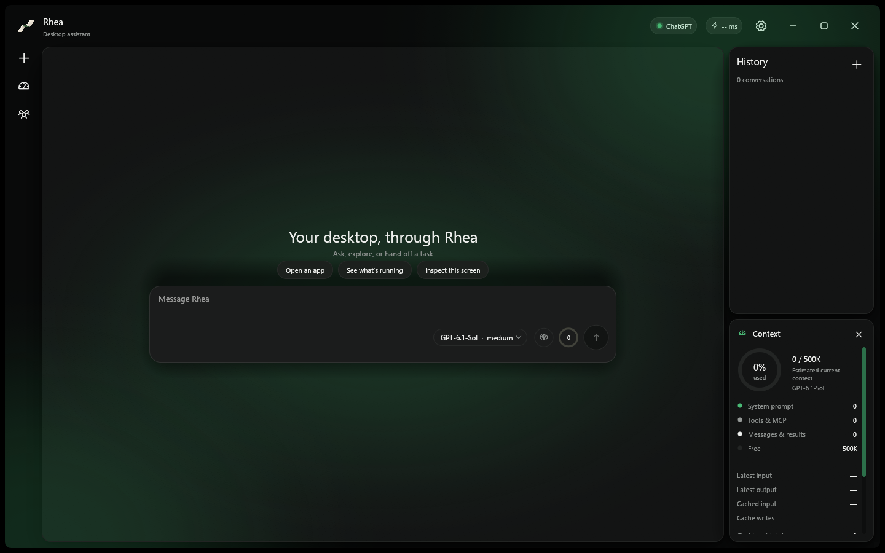

<p align="center"></p>

<h1 align="center">Rhea</h1>

<p align="center">A native desktop assistant for Windows and macOS. ChatGPT plans, Rhea acts on your computer.</p>



> Project status: active development. Windows is the primary, tested platform. The macOS build compiles, passes the unit tests and is packaged on real Macs by GitHub Actions, but its pointer, keyboard and accessibility actions have not had an interactive run on a Mac yet; treat it as a beta.

## What it does

- Streams conversations with the model you pick from your ChatGPT account's catalog, and shows each model's real context window.
- Carries out desktop and browser tasks locally: it reads app controls, performs bounded actions and hands fresh results back to the model. Screenshots are not sent to the model by default.
- Connects to browsers (a Chrome extension you install with one click) and to MCP servers over stdio, Streamable HTTP and legacy HTTP+SSE.
- Runs subagents, a read-only Compose mode, skills, hooks and a `/` command menu.
- Remembers across chats: your preferences and instructions, what it actually did, what failed and what fixed it, and unfinished work, all on your computer ([memory](docs/memory.md)).
- Answers quick decisions on your own computer with a local model (Laya), without a round trip to ChatGPT.
- Keeps chats under `~/.rhea` and sign-in credentials in the operating system's credential store.

Everything in more depth is in [docs](docs/README.md): [skills](docs/skills.md), [slash commands](docs/slash-commands.md), [context](docs/context.md), [MCP](docs/mcp.md), [Chrome extension](docs/chrome-extension.md), [local model](docs/local-model.md), [data and privacy](docs/data-and-privacy.md), [releases](docs/releases.md) and more. Screenshots of every settings page are in [docs/screenshots.md](docs/screenshots.md).

## Build and run

Get a release: download `Rhea-v<version>-windows-x64.exe` from the [Releases](https://github.com/taisrisk/rhea/releases) page and run it. It installs itself to `%LOCALAPPDATA%\Programs\Rhea`, replacing an older install, and your chats and settings stay in `~/.rhea`. On a Mac download the `.dmg` for your chip. Details: [installing and updating](docs/installer.md).

From source, in the repository root:

```sh
cargo run --locked --bin rhea
```

Publish a Windows build and release (bumps the version, builds, commits, tags, pushes and uploads the exe; the Mac builds are attached by GitHub Actions):

```powershell
.\build.ps1
```

## AI Usage

Use **Connect** in Rhea's settings (or the prompt on first start). Rhea runs the official Codex device authorization flow: it opens the device page in your browser and shows the one-time code to enter there. Tokens are kept in the operating system's credential service. Prompts and the tool results needed for an answer go to the connected ChatGPT service; screenshots, full accessibility trees and unrelated files stay on your computer unless you share them.

## Requirements

- **Windows:** Windows 10 version 1809 or newer. To build from source: Rust stable, Node.js 18+ and `npm install --global agent-desktop`.
- **macOS:** macOS 13 or newer, Intel or Apple Silicon. Grant Accessibility (and Screen Recording for screenshots) when asked. Building from source needs Xcode Command Line Tools and Rust. See [macOS](docs/macos.md).
- A ChatGPT account for the assistant itself. The optional local model needs about 1.5 GB of disk and nothing else installed.

## Current limits

- The macOS build has not had an interactive run on a Mac: permissions, app launch, browser connection and desktop actions still need that check.
- Agent Desktop only acts on controls an app's accessibility provider exposes. When a target is missing or ambiguous, Rhea stops and says so.
- A successful build does not prove that an account, MCP server, browser extension or third-party desktop action works end to end.
