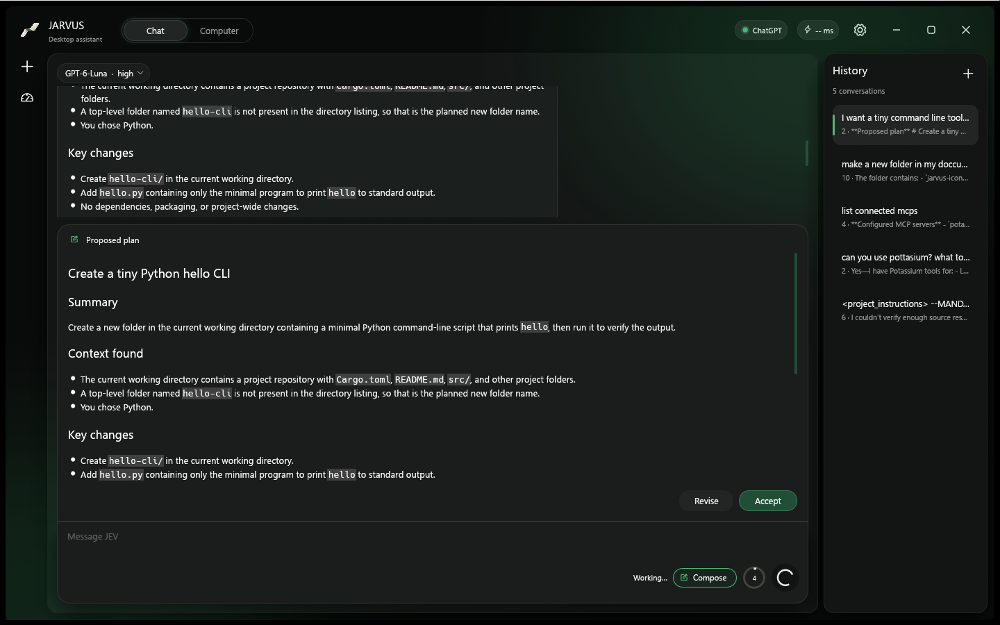
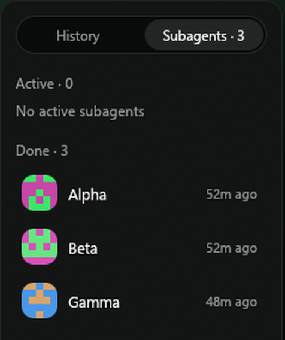

# Compose mode, subagents and hooks

**Compose mode** (the toggle next to the context ring) makes Rhea investigate first: it can read files, search, run read-only commands, browse and ask the local model, but nothing that changes your machine. It asks questions with `ask_user` (a panel that grows out of the chat box), then proposes a plan you **Accept** or **Revise**. Accepting unlocks every tool and Rhea carries the plan out. Bug reports get a debugging section: reproduction, hypotheses, root cause, fix and tests.



**Subagents** let the main model act as a manager. `agent_spawn` starts a worker with its own context and model (default: the main model, changeable in Settings). Workers use the same tools, message the manager and each other with `agent_send`, and every agent sees a live team status. A finished worker keeps its context and can be given a new task. The manager keeps working while workers run, receives each worker's full report as a message, and a turn does not end while workers are running. Each worker gets a generated pixel avatar. The right panel has a **History | Subagents** switcher; click a worker to read its work and message it. While you are using a worker's chat, the send button's ring turns faster the more workers are running.



**Hooks** run your scripts around the agent, in the style of Claude Code and Codex hooks. Configure them in Settings > Agents & hooks or in `~/.rhea/hooks.json`:

```json
{
  "hooks": {
    "PreToolUse": [
      { "matcher": "mcp__rhea_shell__*",
        "hooks": [{ "type": "command", "command": "python check.py", "timeout": 10 }] }
    ]
  }
}
```

Events: `SessionStart`, `UserPromptSubmit`, `PreToolUse`, `PostToolUse`, `Stop`, `SubagentStart`, `SubagentStop`. A hook gets the event as JSON on stdin; exit code 2 blocks (stderr is the reason shown to the model), and JSON on stdout can add `additionalContext`, replace tool input with `updatedInput`, or stop the turn. A hook that fails or times out never blocks the agent. Skills can bring hooks along; see [skills](skills.md). (`mcp__rhea_shell__*` is the Shell tool prefix; the identifier keeps its original name so saved chats stay valid.)
