# Screenshots

The main window: a new chat with the Context panel open.

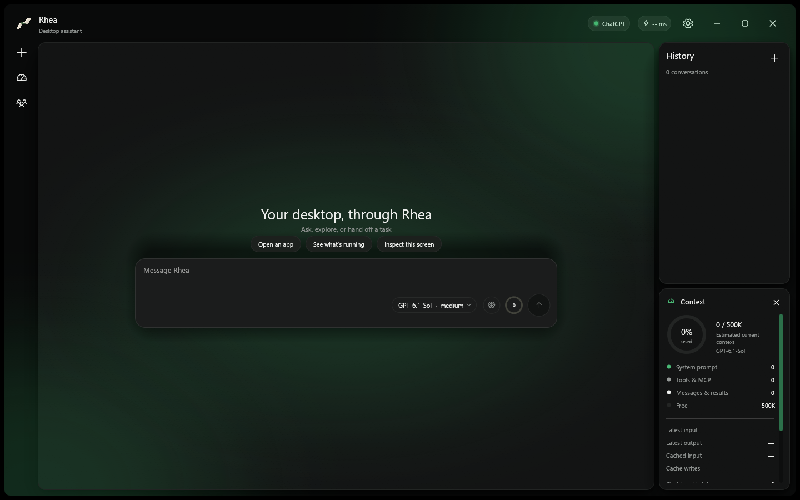

## Settings, one page each

| | |
| --- | --- |
| **Chat & model** 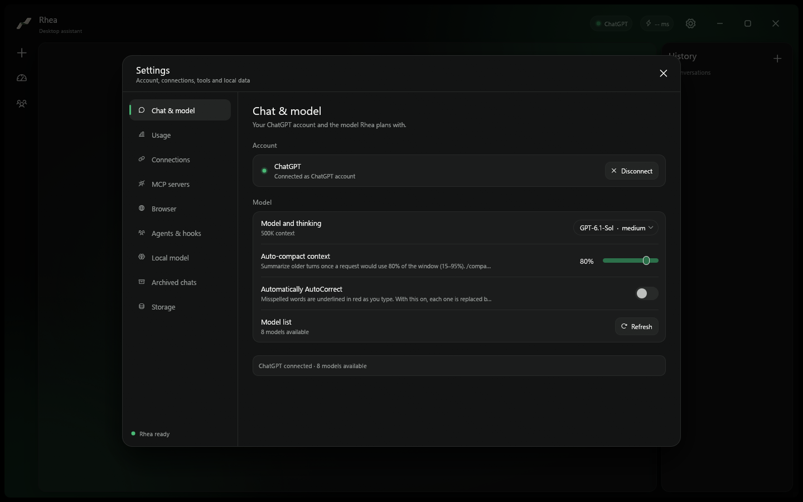 | **Usage** 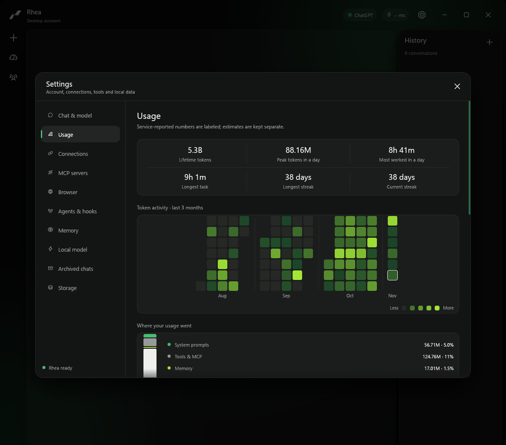 |
| **Connections** 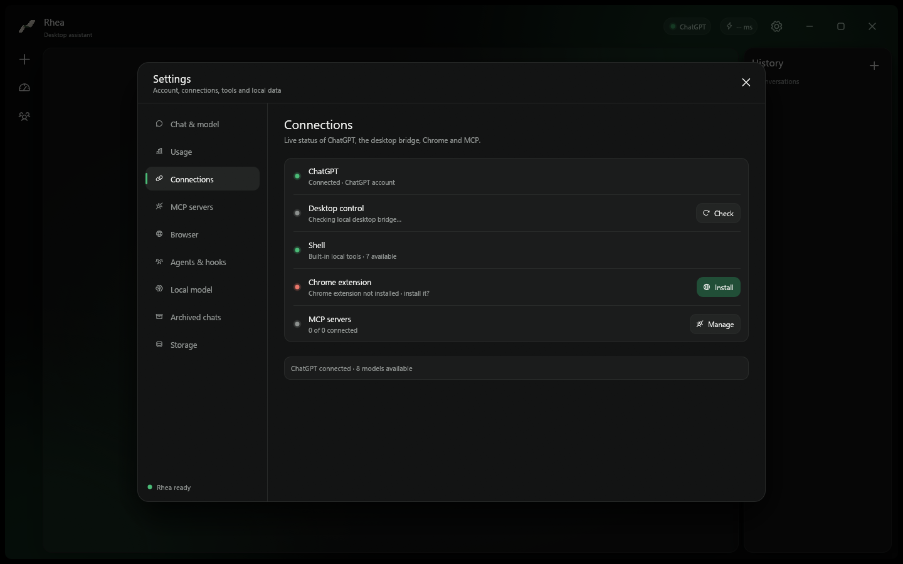 | **MCP servers** 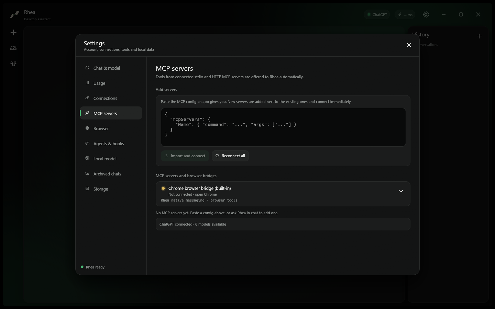 |
| **Browser** 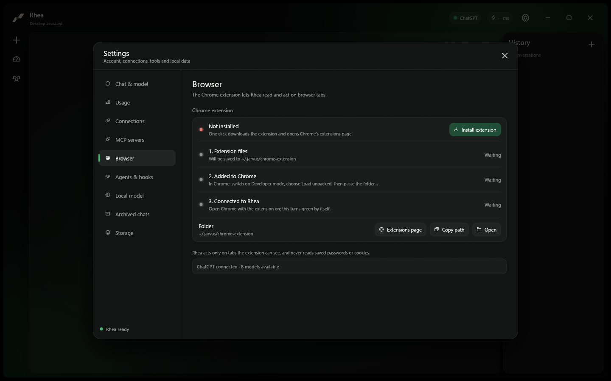 | **Agents, skills & hooks** 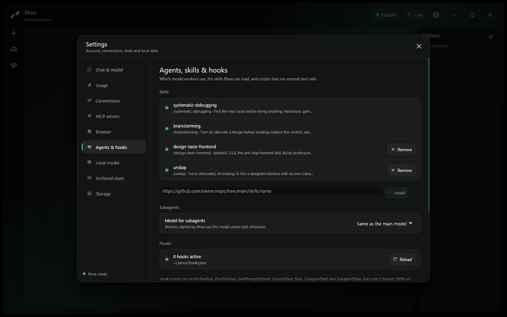 |
| **Memory** 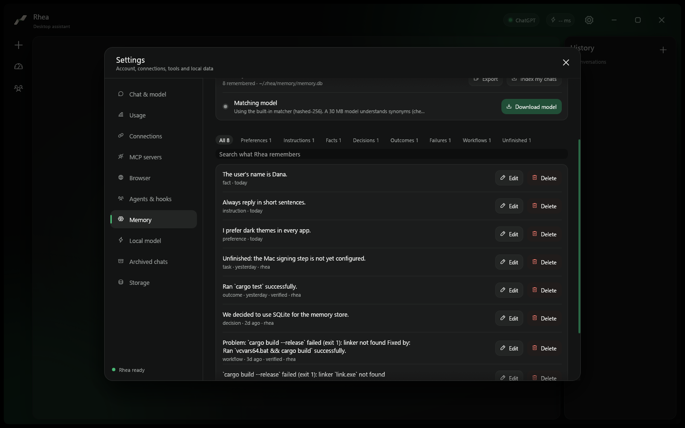 | |
| **Local model** 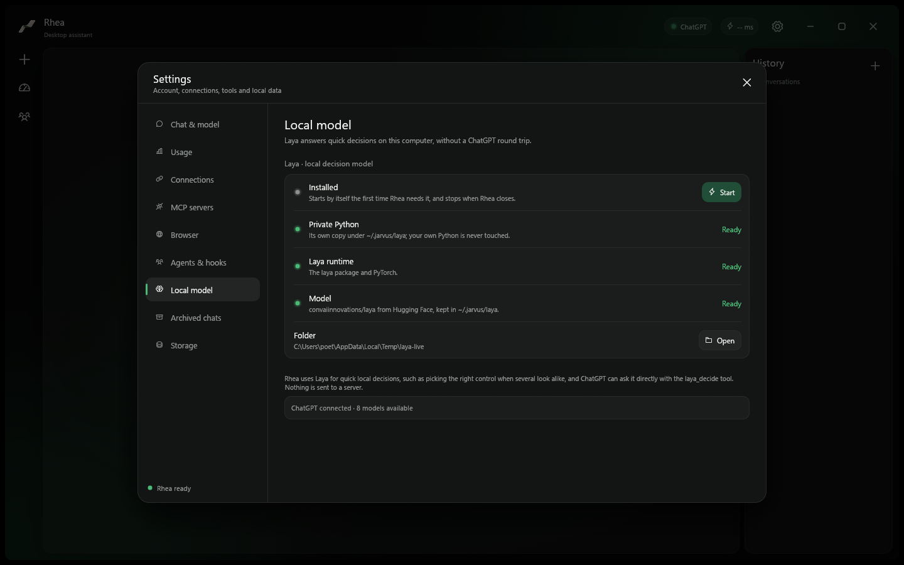 | **Archived chats** 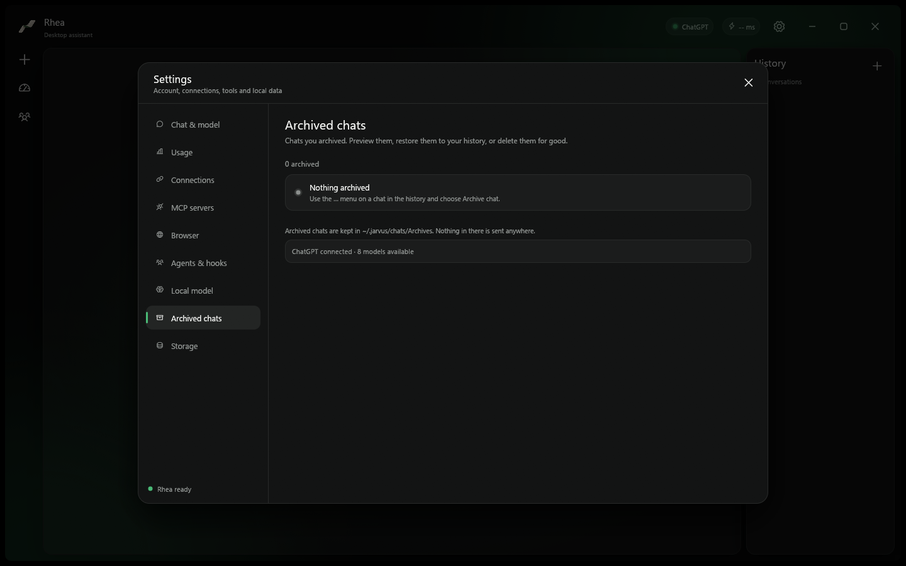 |
| **Storage** 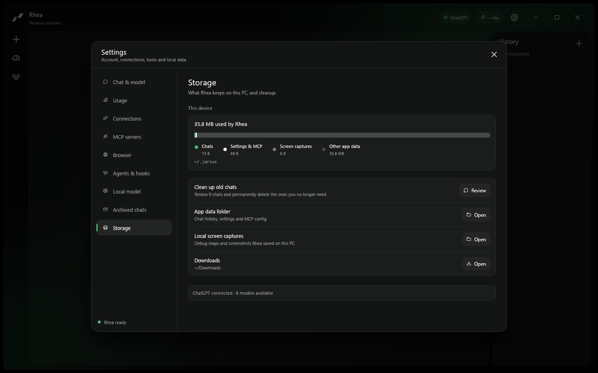 | |

## Compose mode and subagents

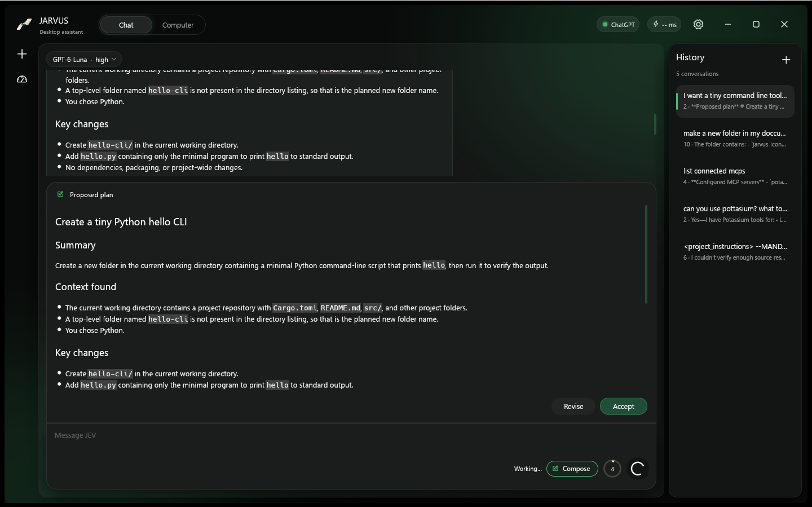

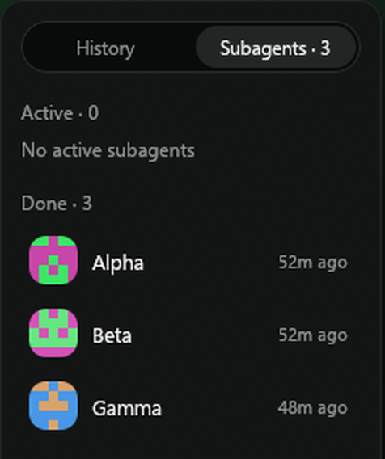

## How these were made

They are captured from a clean profile (no chats, no personal paths) with the demo switches `RHEA_DEMO=1` (hides the signed-in address), `RHEA_DEMO_SETTINGS=<chat|usage|connections|mcp|browser|agents|local|archived|storage>` (opens that settings page), `RHEA_DEMO_CONTEXT=1` (opens the Context panel) and `RHEA_DEMO_DRAFT=<text>`, with `USERPROFILE`, `APPDATA` and `LOCALAPPDATA` pointed at an empty folder.
