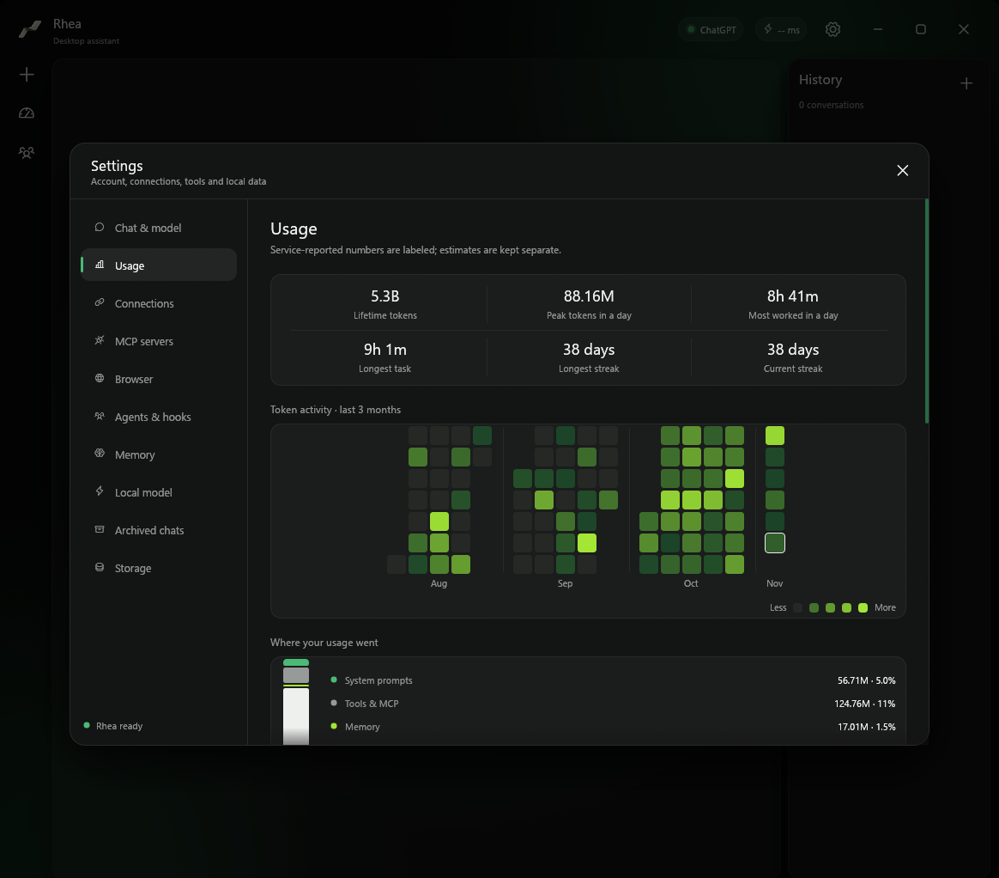

# Usage and fast mode

## Settings > Usage

Usage is counted across **every chat**, including ones you later delete or archive, in `~/.rhea/usage.json`. The file holds small daily totals and counters, never chat content.

- **Profile:** lifetime tokens, peak tokens in one day, the most time worked in one day, the longest single task, the longest streak and the current streak (days with any usage; a streak stays alive until a full day passes with none).
- **Token activity:** the last 3 months, one box per day, with a 3-letter month name under each month and a divider between months. Grey is no use; the more tokens, the greener, up to lime for your busiest day. Hover a box for the date, tokens and time worked.
- **Where your usage went:** a vertical bar with the same pieces as the Context panel (system prompts, tools & MCP, memory in lime, messages & results), plus the replies the model wrote. The pieces are estimates of what each request carried, measured against the size the service reported.
- **Insights:** how many runs used fast mode, your most used reasoning level, total time worked, runs, skills explored (distinct) and skills used.

The first time this record is created it starts from the tokens the chats you already have have used. Usage of chats deleted before that is gone and cannot be recovered. Below these, the page still shows the latest request, timing and recent runs of the open chat.

## Fast mode

The bolt button next to "Thinking" in the model popup turns fast mode on or off (it is remembered). When it is on, requests ask ChatGPT for priority processing (`service_tier: "priority"`). OpenAI documents that parameter for its public API, not for the private `chatgpt.com` backend Rhea actually talks to, so the real speed and usage effect here are unverified — the tooltip now says "priority processing, when the account supports it" rather than claiming a specific multiplier. If the service explicitly rejects the option (an error mentioning `service_tier`) for a model or account, Rhea tells you once, carries on at normal speed, and no longer counts that run as fast in Settings > Usage. This only catches an explicit rejection — the backend does not echo back which tier it actually used, so a silent downgrade the service makes without erroring would still be counted as fast; that gap is still open. Subagents follow the same setting.

## Model limits

The context window shown for a model is the most your ChatGPT account can send it (872K today), not the 272K the catalog recommends. The model popup and the Context panel also show the maximum reply length and the API window OpenAI publishes (1.05M for the GPT-6, GPT-5.6, GPT-5.5 and GPT-5.4 families). See [Context](context.md).
